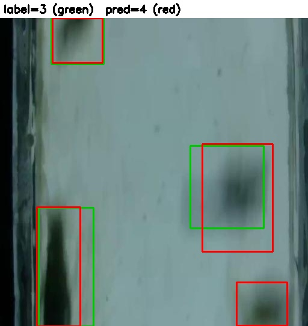
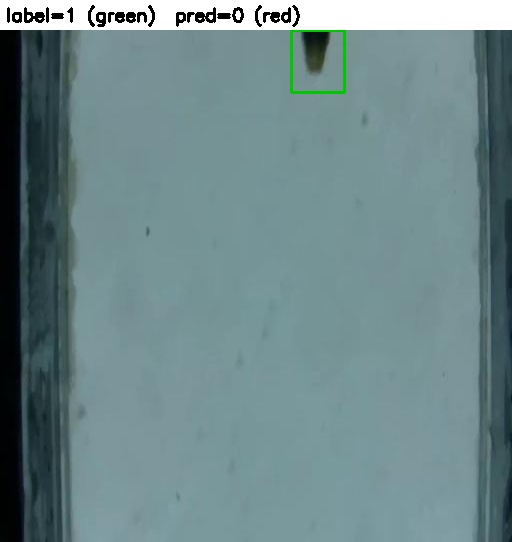

# Fish Counting with a Data-Quality Loop

A small computer vision project: fine-tune a YOLOv8 detector to count fish in images, then use the model's own count errors to review the annotations, fix the clear label mistakes, retrain, and measure what changed.

The point is the data loop (annotation protocol, error-based review, quality control, retraining), not only the model.

## Results

Metric: **MAE** = average absolute difference between predicted and labeled fish count per image (lower is better). Counts come from detections at confidence 0.25.

| Model / setting | Valid MAE | Test MAE |
|---|---|---|
| Round 1, default NMS (IoU 0.7) | 0.20 (a) | 0.30 |
| Round 1, tuned NMS (IoU 0.5) | 0.11 (a) / 0.09 (b) | 0.16 |
| Round 2 (retrained on corrected labels), tuned NMS (IoU 0.5) | 0.13 (b) | 0.13 |

(a) original `valid` labels. (b) after 3 `valid` label corrections.

Detection quality on `valid` (default NMS): round 1 mAP50 0.983, precision 0.947, recall 0.958; round 2 mAP50 0.966, precision 0.952, recall 0.930.

**What I take from this**
- Lowering the NMS IoU threshold from 0.7 to 0.5 cut test MAE from 0.30 to 0.16. The setting was chosen on `valid` and confirmed on the untouched `test` split. The main error source was duplicate boxes on one fish.
- The label review found few real errors (1 missing label, 2 labels on tiny edge slivers in `valid`). Retraining on corrected labels did **not** give a clear improvement: round 2 is better on `test` (0.13 vs 0.16) and worse on `valid` (0.13 vs 0.09). With one run each and differences of a few counted fish, I treat the two rounds as equivalent.
- The remaining errors are mostly hard cases: blurry fish, fish cut off by the image border, and fish crossing each other. These are written up as explicit rules in `ANNOTATION_PROTOCOL.md` (v2).

## Review examples

The review script draws the labels in green and the model's predictions in red. These two images are from the first review of the validation set, before the corrections.

| Missing label (image 1281) | Label on a tiny edge sliver (image 541) |
|---|---|
|  |  |

In 1281 the model finds a fish cut off at the bottom-right edge that has no label (label added). In 541 only a tiny sliver of a fish is labeled at the top edge, which breaks the more-than-half rule (label removed).

## Data

[Fish-Counting](https://universe.roboflow.com/viranga/fish-counting-rtc4t) (version 2) by viranga on Roboflow Universe, license CC BY 4.0. One class (`Fish-Counting`), YOLOv8 format: 830 train / 166 valid / 110 test images. The dataset is not included in this repository; download it from the link above.

## Pipeline

1. `train.py` fine-tunes `yolov8n.pt`.
2. `evaluate.py` compares predicted and labeled counts per image, prints the MAE and writes `errors_<tag>.csv` sorted by error.
3. `review.py` draws labels (green) and predictions (red) on the worst images, so each case can be classified: missing label, wrong label, model miss, duplicate prediction, or ambiguous.
4. `apply_corrections.py` applies the approved fixes from `corrections.csv` (dry run by default, backups before writing, limit on boxes changed per image).
5. Retrain and compare on the same labels. Every decision is logged in `REVIEW_LOG.md`.

## Run it

Tested with Python 3.13, PyTorch 2.8.0 (CUDA 12.8) and Ultralytics 8.4.192 on an RTX 4050 (6 GB). PyTorch 2.11 crashed while saving checkpoints in this setup, so I pinned the older version.

```
pip install -r requirements.txt
pip install torch==2.8.0 torchvision==0.23.0 --index-url https://download.pytorch.org/whl/cu128

python train.py --data data\data.yaml --epochs 50 --name round1
python evaluate.py --weights runs\detect\runs\round1\weights\best.pt ^
    --images data\valid\images --labels data\valid\labels --conf 0.25 --iou 0.5 --tag round1
python review.py --weights runs\detect\runs\round1\weights\best.pt ^
    --images data\valid\images --labels data\valid\labels ^
    --csv errors_round1.csv --conf 0.25 --iou 0.5 --top 15 --out review_round1
python apply_corrections.py --weights runs\detect\runs\round1\weights\best.pt ^
    --data data --csv corrections.csv --conf 0.25 --iou 0.5
```

Ultralytics saves runs under `runs\detect\runs\<name>\` when `--project runs` is used. Round 2 was trained with batch size 8.

Demo: `streamlit run app.py`, then upload an image to get the fish count with boxes drawn. It loads `weights/best.pt`, which is the round 2 model (trained on the corrected labels, batch size 8). The default confidence is 0.25; the demo does not change the NMS IoU, so counts can differ slightly from the 0.5 setting used in the evaluation.

## Limitations

- Single runs, small evaluation sets (166 valid, 110 test images). Differences of about 0.03 MAE are within noise.
- The images look like stretched video frames with many blurry or partly visible fish, so some labels are subjective. Rules for these cases are in the protocol.
- Only the worst-error images were reviewed, so label errors that do not change the count would not be found.
- `apply_corrections.py` adds or removes every unmatched box in an image, so it is meant for clear single-fix cases.
